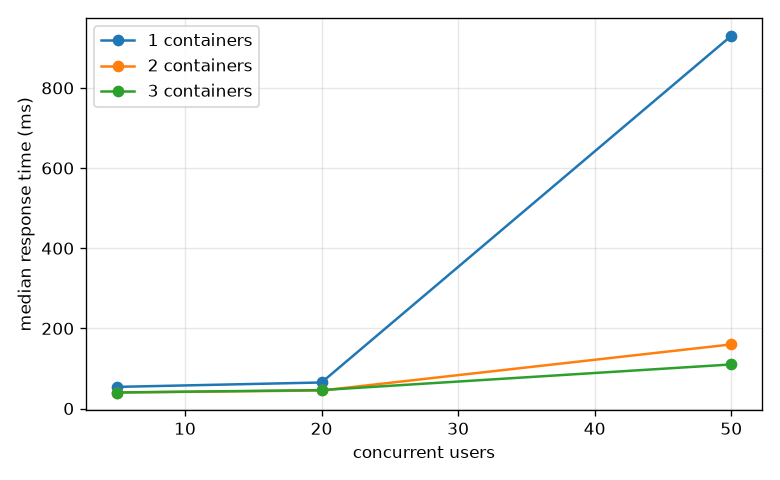
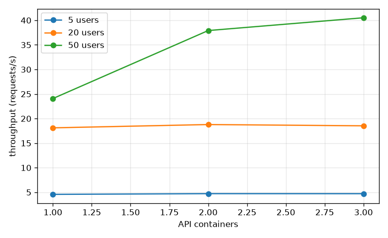
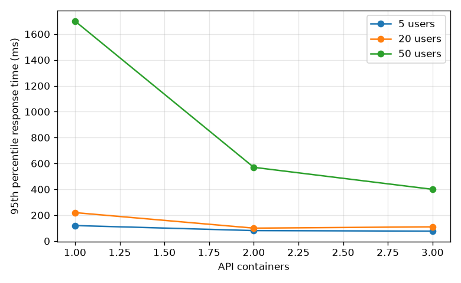
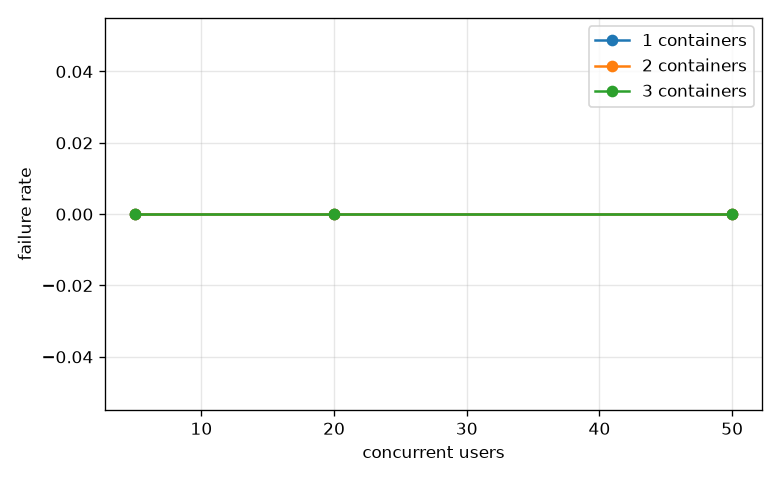

# OvaScope MLOps

End-to-end machine-learning system that classifies microscope images of **parasite eggs** into
**11 classes**, with training, evaluation, a prediction API, a web interface, database-backed uploads,
genuine retraining from the saved model, monitoring, Docker packaging and load testing.

| | |
|---|---|
| 🎬 **Video demo** | **<https://youtu.be/1MOPi_T0RBQ>** |
| 💻 **GitHub** | <https://github.com/N-Maurice/ovascope-MLOP> |
| 🌐 **Running locally** | web app <http://localhost:8080> · API + docs <http://localhost:8000> · Streamlit <http://localhost:8501> (after `docker compose up -d`, see [Quick start](#quick-start-from-github)) |

> **Scope.** The input is an image **cropped around one egg**. OvaScope does not detect or count eggs in a full
> microscope photo, and it is a student research prototype — **not a clinically validated diagnostic tool**.
> Confidence values are model scores, not guarantees.

## Contents
[Quick start](#quick-start-from-github) · 1. [Overview and objectives](#1-overview-and-objectives) · 2. [Dataset](#2-dataset) ·
3. [Architecture](#3-system-architecture) · 4. [Repository structure](#4-repository-structure) · 5. [Installation](#5-installation) ·
6. [Dataset setup](#6-dataset-setup) · 7. [Notebook](#7-notebook-execution) · 8. [Training](#8-training) ·
9. [Results](#9-evaluation-results) · 10. [Prediction](#10-prediction) · 11. [Retraining](#11-retraining) · 12. [API](#12-api) ·
13. [Web interface](#13-web-interface-react-and-streamlit-application) · 14. [Docker](#14-docker) · 15. [Cloud](#15-cloud-deployment) ·
16. [Locust](#16-load-testing-locust) · 17. [Tests](#17-tests) · 18. [Video](#18-video-demonstration) ·
19. [Limitations](#19-limitations-and-future-work) · 20. [References](#20-references)

## Quick start from GitHub

The trained models (`models/versions/`, `.keras` + `.h5`) and a sample of images (`data/train/`, `data/test/`)
are in the repository, so the application runs right after cloning. You need **Git** and **Docker with Compose**
(`sudo bash scripts/install_system_tools.sh` installs Docker on Ubuntu).

```bash
git clone https://github.com/N-Maurice/ovascope-MLOP.git
cd ovascope-MLOP
cp .env.example .env                              # then set OVASCOPE_ADMIN_KEY to a long random string
mkdir -p db data/uploads data/bundle artifacts    # create the mounted folders first (owned by you, not root)
docker compose up -d --build                      # first build: a few minutes
docker compose ps                                 # api, gateway, web, ui -> "Up"
curl localhost:8000/health                        # "model_loaded": true
```

| Open | What |
|---|---|
| <http://localhost:8080> | **web app** (React): classify, classes, dataset, performance, status, admin console |
| <http://localhost:8000> | **API** with interactive documentation (`/docs`) |
| <http://localhost:8501> | Streamlit app (lightweight alternative) |

1. Open the web app → **Sign in → Create account**. The **first account becomes the administrator**.
2. **Predict:** *Classify* → upload an image from `data/test/<class>/` → class, confidence, top-3.
3. **Upload + retrain:** *Admin → Upload* → choose all images of a class folder in `data/train/` (or a ZIP of
   class folders) → *Admin → Retrain* → **Start retraining**. Retraining needs the validation bundle in
   `data/bundle/`: build it once with the full dataset (next block).
4. More containers: `docker compose up -d --scale api=3`. Stop: `docker compose down` (data stays on disk).

**Full dataset (only to retrain or rebuild everything from scratch):**
```bash
conda create -n ovascope python=3.12 -y && conda activate ovascope && pip install -r requirements.txt
python dataset_download/download_dataset.py --prepare   # download from Zenodo (~11.6 GB) + build the crops
python scripts/export_artifacts.py                      # data/bundle for retraining in Docker
python -m src.train --model both --select               # optional: train the models again
```

**Without Docker:** `conda activate ovascope`, then `bash scripts/setup.sh` and `bash scripts/dev.sh`
(API on :8000, web app on :5173). Details in [Installation](#5-installation).

## 1. Overview and objectives

Intestinal parasites are diagnosed by finding their eggs in stool samples under a microscope. This is
slow, skilled work. OvaScope explores how well a compact CNN can recognise the egg species once an egg
has been located.

**Machine-learning objectives:** a verified, leakage-free dataset; a reproducible baseline CNN; a
transfer-learning model chosen on validation data; honest evaluation on a protected test set.
**MLOps objectives:** one shared preprocessing path for training and serving; versioned models;
database-backed uploads; retraining that continues from the saved model with a promotion check; monitoring;
containerisation; load testing.

## 2. Dataset

| | |
|---|---|
| Source | [Chula-ParasiteEgg-11, Zenodo record 15866298](https://zenodo.org/records/15866298) (ICIP 2022 challenge) |
| Content | 11,000 training + 2,200 test photos of faecal smears from several microscopes, cameras and smartphones |
| Annotations | COCO JSON, bounding box + class for every egg (11,031 train, 2,228 test); test labels in `test_labels_200.json` |
| Classes | 0 Ascaris lumbricoides · 1 Capillaria philippinensis · 2 Enterobius vermicularis · 3 Fasciolopsis buski · 4 Hookworm egg · 5 Hymenolepis diminuta · 6 Hymenolepis nana · 7 Opisthorchis viverrini* · 8 Paragonimus spp. · 9 Taenia spp. egg · 10 Trichuris trichiura |

\*The official label is spelled *Opisthorchis viverrine*; it is kept unchanged in `class_map.json` (`original_name`)
and only the display name is normalised.

**Preprocessing for classification.** Every box is padded by 10%, made square and cropped, which gives
**13,259 single-egg crops**:
- **train:** 9,379 crops (85% of the official training photos).
- **validation:** 1,652 crops (15%).
- **test:** 2,228 crops, from the official test set.

The train/validation split is stratified by class and **grouped by source photo**. The audit found no
exact or near-duplicate photos across splits. The crop dataset rebuilds **byte-for-byte identically** from
the official archives. Details: [reports/dataset_audit.md](reports/dataset_audit.md) and [data/README.md](data/README.md).

**Limitations of the data.** Photo quality varies strongly (focus, colour, illumination). 119 boxes run past
the photo edge. The test photos are darker and sharper than the training photos on average. Size cues
vary with magnification.

## 3. System architecture

```
 Zenodo archives ─► src/preprocessing.py ─► crops + manifest ─► src/train.py ─► models/versions/vNNN_*/
                                                                    │                (keras, h5, metadata)
                                                                    ▼                        │ activate
                                              notebook/ovascope_ml_pipeline.ipynb      models/active_model.json
                                                                                              │
  Browser ─► React app (web/) ─/api─► nginx ─► FastAPI × N (api/) ─► src/prediction.py ◄──────┘
            (or Streamlit, app/)              │   ├─ egg gate (src/gate.py) refuses non-egg images
                                                   │   ├─ /upload ─► src/database.py (SQLite: image BLOBs)
                                                   │   └─ /retrain ─► src/retrain.py (separate process):
                                                   │        load active model → new + replay images → fit →
                                                   │        evaluate vs active on validation → new version → promote?
                                                   └─ src/monitoring.py (request log, latency, uptime)
```

## 4. Repository structure

| Path | Purpose |
|---|---|
| `configs/config.yaml` | all settings (paths, image size, epochs, learning rates, retraining thresholds) |
| `src/config.py` | loads the config; environment-variable path overrides for Docker/Colab/Kaggle |
| `src/preprocessing.py` | crop generation, verification, image statistics, resize/augment/`tf.data` pipeline |
| `src/model.py` | baseline CNN and MobileNetV2 transfer model |
| `src/train.py` | training recipes, callbacks, versioned saving (`.keras` + load-tested `.h5`) |
| `src/evaluation.py` | metrics, confusion matrix, curves, example grids, latency |
| `src/prediction.py` | `Predictor`: load a version and classify one image |
| `src/database.py` | SQLite schema, upload validation and storage, retraining job records |
| `src/retrain.py` | retraining job: continue from the active model, evaluate, version, promote |
| `src/monitoring.py` | request log, latency statistics, uptime |
| `src/registry.py` | model versions, active pointer, rollback |
| `api/main.py` | FastAPI service |
| `src/gate.py` | egg gate: refuses images that are not parasite eggs |
| `src/results.py` | read-only access to saved evaluation results for the web interface |
| `src/users.py` | accounts: password hashing, sessions, roles; CLI `python -m src.users` |
| `scripts/setup.sh`, `scripts/dev.sh`, `scripts/install_system_tools.sh`, `Makefile` | setup and run helpers |
| `web/` | React + TypeScript web interface (main UI, see `web/README.md`) |
| `app/streamlit_app.py` | lightweight Streamlit interface (6 pages) |
| `notebook/ovascope_ml_pipeline.ipynb` | full documented ML lifecycle with real outputs |
| `scripts/` | `prepare_data.py`, `audit_dataset.py`, `evaluate_final.py`, `evaluate_deployed.py`, `export_artifacts.py` |
| `dataset_download/download_dataset.py` | downloads the dataset from Zenodo (resumable, MD5-checked) and rebuilds the crops |
| `data/train/`, `data/test/` | small image sample in git (5 train + 3 test crops per class) for trying prediction and upload |
| `src/mongo_sync.py` | optional copy of the records in MongoDB Atlas |
| `tests/` | pytest suite (preprocessing, prediction, API, retraining) on a synthetic mini-dataset |
| `load_testing/` | Locust file, experiment runner, analysis, results (CSV + plots in `load_testing/results/`) |
| `models/` | model versions (`versions/`), active model copies, protected test hashes |
| `artifacts/` | metrics, plots, logs, exports |
| `reports/` | dataset audit |
| `docs/` | deployment guide, demo checklist |

## 5. Installation

**What you need**

| Tool | Version | Used for | Install |
|---|---|---|---|
| Python | 3.12 | training, API, tests | Miniconda, or `apt install python3.12` |
| Node.js + npm | 20 or newer | web interface (`web/`) | `sudo bash scripts/install_system_tools.sh` |
| Docker + Compose | any recent | containers (optional) | `sudo bash scripts/install_system_tools.sh` |
| make | any | shortcuts (optional) | `sudo bash scripts/install_system_tools.sh` |

`scripts/install_system_tools.sh` installs Docker, Compose, make and (if missing) Node.js from Ubuntu's own
packages and adds you to the `docker` group (log out and in afterwards).

**Quick setup** (after creating the Python environment below):
```bash
bash scripts/setup.sh      # checks tools, installs Python + web packages, creates .env and the database
bash scripts/dev.sh        # API on :8000 + web app on http://localhost:5173   (or: make dev)
```
Open the web app and choose **Sign in → Create account**: the first account becomes the administrator.

Python 3.12 is required (TensorFlow 2.21 has no build for Python 3.13+).

```bash
conda create -n ovascope python=3.12 -y && conda activate ovascope
pip install -r requirements.txt                       # CPU
# NVIDIA GPU: pip install "tensorflow[and-cuda]==2.21.0" instead of tensorflow
```

With pip-installed CUDA libraries, TensorFlow may print *"Cannot dlopen some GPU libraries"* (libcusolver).
Add the NVIDIA library folders to the library path:
```bash
export LD_LIBRARY_PATH=$(ls -d $CONDA_PREFIX/lib/python3.12/site-packages/nvidia/*/lib | tr '\n' ':')
```

## 6. Dataset setup

One command downloads the three official files from [Zenodo](https://zenodo.org/records/15866298) into
`data/raw/` (resumable, MD5-verified) and builds the crops:

```bash
python dataset_download/download_dataset.py --prepare --audit
```

Or step by step (after downloading `Chula-ParasiteEgg-11.zip`, `Chula-ParasiteEgg-11_test.zip` and
`test_labels_200.json` into `data/raw/` yourself):

```bash
python scripts/prepare_data.py          # verify MD5s → unzip → build crops → verify (≈3 min with 16 cores)
python scripts/audit_dataset.py         # audit: duplicates, leakage, statistics → artifacts/metrics/
```
See [dataset_download/README.md](dataset_download/README.md) and [data/README.md](data/README.md).

## 7. Notebook execution

`notebook/ovascope_ml_pipeline.ipynb` covers the whole lifecycle (24 sections). It reuses the `src/` code and
detects its environment automatically (settings cell in Section 3).

| | How |
|---|---|
| **Local** | `conda activate ovascope && jupyter lab notebook/ovascope_ml_pipeline.ipynb`. Data from `data/`, outputs to `models/` and `artifacts/` |
| **Google Colab** | Upload and unzip the project to `/content/ovascope-MLOP` (or set `PROJECT_REPO_URL`). Upload `chula_parasite_egg11_crops.zip` (or set `USE_GOOGLE_DRIVE = True` and keep it on Drive). Choose a GPU runtime, then *Run all*. The results ZIP is offered via `files.download()` |
| **Kaggle** | Attach two input datasets: the project folder and `chula_parasite_egg11_crops.zip`. Enable GPU and internet (internet is needed for ImageNet weights; otherwise attach the MobileNetV2 weights file and pass its path). *Save Version* → download `ovascope_outputs/artifacts/exports/ovascope_training_results.zip` from the **Output** tab |

`QUICK_RUN = True` trains for 1–2 epochs to check the setup (≈5 min on a GPU).
`REBUILD_CROPS = True` rebuilds the crops from the official archives when they are available and proves the
rebuild is identical.

## 8. Training

```bash
python -m src.train --model both --select    # baseline CNN + MobileNetV2, activate the better (validation macro-F1)
python scripts/evaluate_final.py             # validation comparison + one-time test evaluation of the active model
python scripts/export_artifacts.py           # results ZIP + deployment data bundle
```

Optimisation techniques:
- **Adam** optimiser.
- **Dropout** 0.3.
- **Augmentation:** flips, rotation, shift, zoom, ±10% brightness and contrast.
- **Early stopping** with best-weight restoration.
- **ReduceLROnPlateau** and best-checkpoint saving.
- **Transfer learning** from ImageNet.
- **Fine-tuning** of the upper MobileNetV2 layers at lr 1e-5, with BatchNorm frozen.

Seeds are fixed (42); some GPU kernels remain non-deterministic.

## 9. Evaluation results

Two models were trained and compared on the **validation** set; the better one (MobileNetV2) was then evaluated
**once** on the protected **test** set (2,228 crops from the official test photos, never used for any choice).

| Model | Split | Accuracy | Precision | Recall | F1 (macro) | ROC-AUC | PR-AUC | Log loss |
|---|---|---|---|---|---|---|---|---|
| Baseline CNN (v003, 0.39 M parameters) | validation | 0.843 | 0.846 | 0.843 | 0.842 | 0.986 | 0.911 | 0.527 |
| MobileNetV2 transfer (v004, 2.27 M) | validation | **0.930** | 0.933 | 0.930 | **0.931** | 0.997 | 0.976 | 0.231 |
| **MobileNetV2 (v004, deployed)** | **test** | **0.811** | 0.825 | 0.811 | **0.810** | 0.986 | 0.910 | 0.614 |

Per class (test F1): Taenia 0.94 · Trichuris 0.88 · Hookworm 0.87 · Fasciolopsis 0.85 · Enterobius 0.85 ·
Opisthorchis 0.83 · Paragonimus 0.80 · Hymenolepis diminuta 0.78 · Hymenolepis nana 0.72 · Ascaris 0.72 ·
Capillaria 0.66.

**Interpretation.** The drop from validation (0.93) to test (0.81) is a real distribution shift, not leakage
(the audit found no duplicates across splits): the official test photos are darker and sharper on average and
come from different capture conditions. The most frequent test errors are Ascaris → *H. diminuta* (39),
*H. nana* → *H. diminuta* (38), Capillaria → Opisthorchis (31), Capillaria → Enterobius (24) and Paragonimus →
Fasciolopsis (23): eggs with similar size and shell appearance. A ROC-AUC of 0.986 shows the correct class is almost
always ranked high, so the top-3 shown in the interface is useful.

**Egg gate** (refuses images that are not parasite eggs, `src/gate.py`): on the test set it accepts 98.3% of real
egg crops and rejects 94.1% of non-egg images (ROC-AUC 0.997).

Plots: `artifacts/plots/` (confusion matrix, ROC/PR curves, training curves, per-class validation vs test) and
the notebook (Sections 13, 17, 18). All numbers come from `artifacts/metrics/`.

## 10. Prediction

```python
from src.config import load_config
from src.prediction import Predictor
predictor = Predictor.from_active(load_config())
predictor.predict_file("data/processed/crops/test/10_trichuris_trichiura/<file>.jpg")
# {'predicted_class_id': 10, 'predicted_class': 'Trichuris trichiura', 'confidence': ..., 'top_k': [...], 'model_version': ...}
```
or `curl -F file=@egg.jpg http://localhost:8000/predict`.

## 11. Retraining

1. **Upload:** labelled images go to the *Upload* page or `POST /upload`. Labels come from one label for all
   files, a per-file list, or a ZIP with one folder per class.
2. **Validation:** each file is checked for extension, size (≤ 10 MB) and that it decodes. Its label must be
   in the class map, and exact duplicates are rejected (SHA-256). Copies of protected test images are also
   rejected.
3. **Storage:** accepted images are stored **as BLOBs in SQLite** (`db/ovascope.db`, table `uploads`), with a
   browsable copy in `data/uploads/`.
4. **Retrain:** *Retrain Model* / `POST /retrain` creates a job record, and a second job cannot start while
   one is running. A separate process then:
   - loads the **active saved model**;
   - trains it for 3 epochs at lr 1e-5 on the new images (×3) plus 100 replay crops per class;
   - evaluates the candidate and the active model on the validation set;
   - saves the candidate as a new version (`vNNN_retrain`);
   - **activates it only if** macro-F1(candidate) ≥ macro-F1(active) − 0.005.
   The previous versions are kept, so you can roll back (`POST /model/rollback`).
5. **Automatic trigger:** when `retraining.trigger_threshold` (default 50) validated new images are waiting,
   retraining is flagged *recommended*. With `auto_start: true` it starts by itself. The threshold is a
   configurable operating choice, not an optimised value.

## 12. API

`uvicorn api.main:app --port 8000` → interactive docs at `http://localhost:8000/docs`.

| Endpoint | Method | Purpose |
|---|---|---|
| `/health` | GET | service status, uptime since process start, model loaded/version, serving container |
| `/predict` | POST | classify one uploaded image (multipart field `file`) |
| `/upload` | POST 🔒 | upload labelled images (`files`, plus `label` or `labels`, or a class-folder ZIP) |
| `/uploads`, `/uploads/{id}/image` | GET 🔒 | stored records and counts; one stored image |
| `/retrain` | POST 🔒 | start a retraining job (HTTP 202 + job id; 409 if not possible) |
| `/retrain/status` | GET | readiness, pending images, trigger flag, latest job |
| `/retrain/status/{job_id}` | GET | job status, progress, metrics, promotion decision |
| `/model/info` | GET | active model metadata |
| `/model/versions` | GET | all versions and their metrics |
| `/model/activate/{version}`, `/model/rollback` | POST 🔒 | switch the active model |
| `/metrics` | GET | request counts, failures, latency, recent activity, retraining events |
| `/classes`, `/classes/{id}/examples/{n}` | GET | class list; validation example crops (test crops are never served) |
| `/results/evaluation` | GET | final test + validation metrics, confusion matrices, model comparison, accuracy by camera |
| `/results/history/{version}` | GET | per-epoch training history of a version |
| `/dataset/summary` | GET | dataset audit: splits, class balance, leakage checks, crop sizes |
| `/gate` | GET | egg-gate threshold and results |
| `/auth/register`, `/auth/login` | POST | create an account; sign in with username **or** email + password → session token |
| `/auth/me`, `/auth/logout`, `/auth/password` | GET, POST, POST | current account; end the session; change password (signed in) |
| `/auth/status`, `/auth/verify` | GET, POST 🔒 | sign-up/first-admin state; check admin credentials |
| `/users`, `/users/{id}` | GET, PATCH, DELETE 🔒 | list accounts; change role (admin/user) or active flag; delete |
| `/mongo/status`, `/mongo/sync` | GET, POST 🔒 | MongoDB Atlas copy: state, last sync, document counts; copy now |

🔒 requires an **administrator**: either `Authorization: Bearer <token>` from `/auth/login` of an account with the
admin role, or the operator header `X-API-Key: <OVASCOPE_ADMIN_KEY>` (scripts, Streamlit, load tests).

**Accounts.** Stored in the SQLite database (`users`, `sessions`); passwords as salted scrypt hashes, sessions as
SHA-256 hashes of random tokens (7 days, or 1 day without "keep me signed in"). The **first account becomes admin**;
later sign-ups are `user` until an admin promotes them (admin console → Users). The last active admin cannot be
demoted, deactivated or deleted. Five failed sign-ins for the same name block that name for five minutes.
Settings: `auth:` in `configs/config.yaml` (`allow_signup`, `session_days`, `min_password_length`).
Command line: `python -m src.users create-admin --username NAME --email MAIL`, `reset-password --login NAME`, `list`.
Uploads and retraining jobs record which account made them (`uploaded_by`, `requested_by`).
Only on a fresh install with **no** accounts and **no** `OVASCOPE_ADMIN_KEY` are admin endpoints open (development).
The model is loaded once and swapped atomically when the active version changes. Retraining never runs inside a request.

**MongoDB Atlas copy (optional).** SQLite stays the main store; when `MONGODB_URI` is set in `.env`, the API also
copies the records to MongoDB (database `ovascope`): `uploads` (with the image bytes), `retrain_jobs`, `request_log`,
`models` and `users` (username, role and dates only: password hashes and email addresses stay local). The copy runs
every 60 s and right after uploads, retraining starts and account changes; it is an idempotent upsert, so the API
keeps working while the cluster is unreachable and catches up afterwards. Settings: `mongodb:` in
`configs/config.yaml`. Atlas only accepts connections from IP addresses listed under **Security → Network Access**.
Admin console → Records shows the state and has a **Sync now** button; from the command line:
`python -m src.mongo_sync status` (connection check + counts) and `python -m src.mongo_sync push` (copy now).
Browse the documents in Atlas (**Browse Collections**) or with the MongoDB extension for VS Code.

## 13. Web interface (React) and Streamlit application

**React app (`web/`, main interface).** Works on laptop and phone screens, light and dark mode.
```bash
OVASCOPE_ADMIN_KEY=choose-a-key uvicorn api.main:app --port 8000     # terminal 1
cd web && npm install && npm run dev                                 # terminal 2 -> http://localhost:5173
```
Pages: Home, Classify (crop one egg, top-3, egg check, reference and look-alike crops), Classes, Dataset,
Performance (metrics, confusion matrix, per-class table, training curves, egg check), Status (live monitoring),
About, and an admin console behind sign-in (upload, database records, retraining with live progress,
model activation and rollback). Details: `web/README.md`.

**Streamlit (lightweight alternative):**
`OVASCOPE_API_URL=http://localhost:8000 streamlit run app/streamlit_app.py`

The app has six pages:
1. **Dashboard:** status, model, uptime, requests, retraining.
2. **Predict:** upload, preview, class, confidence, top-3 and version.
3. **Dataset insights:** class distribution, plus brightness, size and texture/colour, each with an interpretation.
4. **Upload training data.**
5. **Train & retrain:** Retrain button, job status, version comparison, activation and rollback.
6. **Monitoring:** health, latency, failures, recent requests, evaluation results.

## 14. Docker

```bash
python scripts/export_artifacts.py               # builds data/bundle (validation set + replay sample; needs the dataset)
cp .env.example .env                             # set OVASCOPE_ADMIN_KEY (MONGODB_URI optional)
mkdir -p db data/uploads data/bundle artifacts   # mounted folders, created by you (the API runs as your user)
docker compose up -d --build                     # web app :8080, gateway :8000, Streamlit :8501, 1 API
docker compose up -d --scale api=3               # 3 API containers behind nginx
curl localhost:8000/health                       # "instance" = container that answered
docker compose logs -f api                       # logs
docker compose down                              # stop (models/, db/, uploads persist on the host)
```
The images contain code and dependencies only. Models, database, uploads and the data bundle are mounted,
so nothing large is baked in and everything survives restarts.

| Container | Image | Port | Role |
|---|---|---|---|
| `web` | `web/Dockerfile` (Vite build served by nginx) | 8080 | React app; proxies `/api` to the gateway |
| `gateway` | `nginx:1.27-alpine` + `deploy/nginx.conf` | 8000 | load balancer (`least_conn`) over all API containers |
| `api` × N | `Dockerfile`, target `api` (TensorFlow CPU) | internal 8000 | FastAPI; limits: 2 CPUs, 5 GB (`API_CPUS`, `API_MEMORY` in `.env`) |
| `ui` | `Dockerfile`, target `ui` | 8501 | Streamlit app |

**Verified with Docker Compose 2.40 (Ubuntu):** all containers healthy; prediction, the egg gate, sign-up and
sign-in, bulk upload to the database and retraining (≈5 min on 2 CPUs, promoted or rejected by the gate rule)
run inside the containers; `--scale api=3` spreads requests over three containers. The API runs as the host user
(`HOST_UID`/`HOST_GID`, default 1000), so the files it writes in `db/` and `models/` stay yours.
TensorFlow's thread pools follow the container's CPU quota, which keeps memory flat during retraining and
throughput stable under many concurrent requests.

## 15. Cloud deployment

**Target: AWS EC2.** The cloud runs the same Docker Compose stack as section 14 on one Ubuntu 24.04 instance
(`m7i-flex.large` or `t3.large`: 2 vCPU, 8 GB RAM, 30 GB disk, Elastic IP), because retraining needs TensorFlow,
persistent storage and several API containers, which free single-container PaaS tiers do not provide.
[scripts/deploy_vm.sh](scripts/deploy_vm.sh) installs Docker, clones this repository, creates `.env` with a random
admin key and starts the containers. On the server, [docker-compose.cloud.yml](docker-compose.cloud.yml) adds
**Caddy**, which terminates HTTPS (automatic Let's Encrypt certificates) for the two public names:

| Address | Serves |
|---|---|
| https://ovascope.mauricenshimyumukiza.world | web app (React) |
| https://ovascope.api.mauricenshimyumukiza.world | REST API, interactive docs at `/docs` |

The security group opens only ports 80 and 443 (plus SSH); `docker-compose.yml` itself is unchanged.
Step-by-step guide (instance settings, security group, data bundle upload, verification):
[docs/deployment.md](docs/deployment.md).

**Evaluating the model in production.** `scripts/evaluate_deployed.py` sends labelled held-out test crops to the
running service's `POST /predict` and computes accuracy and macro-F1 from the API's answers, so the deployed
model is checked end to end (preprocessing, egg gate, model, API), separately from latency monitoring:
```bash
python scripts/evaluate_deployed.py --url http://localhost:8000 --per-class 0    # 0 = all 2,228 test crops
```
Result against the Docker deployment (3 API containers, all 2,228 test crops, `artifacts/metrics/production_evaluation.json`):

| | Offline test (notebook) | Deployed API |
|---|---|---|
| accuracy | 0.811 | 0.812 |
| macro-F1 | 0.810 | 0.811 |
| model version | v004_mobilenetv2 | v004_mobilenetv2 |
| refused by the egg gate | – | 37 of 2,228 real egg crops (1.7%); metrics cover the 2,191 accepted |
| client latency | – | median 34 ms, p95 43 ms |

The deployed service reproduces the offline test result, so preprocessing in production matches training.

## 16. Load testing (Locust)

**Setup.** `load_testing/locustfile.py`: each simulated user posts a real test crop (fixed set of 110 images,
10 per class, 3.6–358 KB) to `POST /predict`, waiting 0.5–1.5 s between requests. `load_testing/run_experiments.sh`
runs **5, 20 and 50 users** for **60 s** each against **1, 2 and 3 API containers** (2 CPUs each) behind the nginx
gateway; `load_testing/analyze_results.py` writes the table and plots. Measured on one machine (Intel Core
i7-10875H, 8 cores / 16 threads, 14 GB RAM) with Docker Compose.

```bash
bash load_testing/run_experiments.sh            # ≈12 min; results in load_testing/results/
```

| Containers | Users | Requests | Failures | Requests/s | Median (ms) | Mean (ms) | p95 (ms) | Max (ms) |
|---|---|---|---|---|---|---|---|---|
| 1 | 5 | 270 | 0 | 4.6 | 54 | 125 | 120 | 3,705 |
| 1 | 20 | 1,068 | 0 | 18.1 | 65 | 89 | 220 | 718 |
| 1 | 50 | 1,421 | 0 | 24.1 | **930** | 925 | **1,700** | 2,305 |
| 2 | 5 | 277 | 0 | 4.7 | 40 | 78 | 81 | 2,242 |
| 2 | 20 | 1,109 | 0 | 18.8 | 45 | 53 | 100 | 171 |
| 2 | 50 | 2,239 | 0 | 37.9 | **160** | 213 | **570** | 1,028 |
| 3 | 5 | 278 | 0 | 4.7 | 40 | 71 | 77 | 1,678 |
| 3 | 20 | 1,093 | 0 | 18.5 | 46 | 56 | 110 | 174 |
| 3 | 50 | 2,392 | 0 | 40.5 | **110** | 140 | **400** | 803 |

| Response time vs users | Throughput vs containers |
|---|---|
|  |  |
|  |  |

**Interpretation.**
- **No request failed** in any configuration (0 of 10,147).
- At **5 and 20 users** the load is below what one container can handle; throughput is set by the users' wait
  time (≈ users ÷ 1 s), and the median stays at 40–65 ms. Extra containers mainly trim the tail (p95 220 → 110 ms).
- At **50 users one container saturates** (2 CPUs fully busy): requests queue, the median rises to 930 ms and
  throughput levels off at 24 requests/s. **Two containers** remove most of the queue (38 req/s, median 160 ms,
  p95 570 ms) and **three** bring the median to 110 ms and p95 to 400 ms at 40 req/s, close to the 45 req/s the
  50 users can generate. Scaling out therefore pays off once one container is CPU-bound.
- The maximum values include the first requests after start-up (model warm-up).
- Two settings made this scaling work, found during these tests: the gateway uses **`least_conn`** (plain
  round-robin left containers idle while others queued), and TensorFlow's thread pools follow the container's
  CPU quota (without it, 50 users on 3 containers gave only 12.5 req/s with a 2.5 s median).

Raw Locust CSVs, per-container CPU/memory snapshots (`*_docker_stats.csv`) and the summary
(`load_test_summary.csv`) are in `load_testing/results/`.

## 17. Tests

```bash
pytest -q
```
The tests cover:
- preprocessing (shapes, ranges, channels, invalid images, train/serve consistency);
- prediction (loading, valid indices and probabilities, class names, `.h5` equality);
- the API (all endpoints, upload validation, ZIP folders, auth);
- retraining (loads the saved model, creates a new version, keeps the old one, failure safety,
  duplicate-job prevention, trigger).

They run on a synthetic mini-dataset in a temporary folder and never touch the real models, database or MongoDB
cluster. Current result: **81 passed** (`pytest -q`, about 40 s on CPU). The suite also covers accounts and roles,
database migrations, stale retraining jobs and the MongoDB copy (with `mongomock`). Web interface: `cd web && npm run build`.

## 18. Video demonstration

▶️ **<https://youtu.be/1MOPi_T0RBQ>**: dataset and notebook, Docker deployment, web app on laptop and phone,
live prediction, accounts, bulk upload to the database, retraining with the promotion decision, monitoring,
MongoDB Atlas copy and load testing.

## 19. Limitations and future work

- **Single-egg crops only.** The model classifies an image centred on one egg; it does not find or count eggs in a
  full microscope photo. Future work: an object detector (the original boxes are kept in `data/extracted/`).
- **Domain shift.** Test accuracy (81%) is lower than validation (93%) because the test photos differ in
  brightness and sharpness. More varied training data, colour normalisation or test-time augmentation could help.
- **Look-alike species** (the two *Hymenolepis*, Capillaria/Opisthorchis, Ascaris/*H. diminuta*) remain the main source of errors.
- **Retraining on CPU** takes about 5 minutes for a small batch; large uploads would need a GPU worker or a job queue.
- **Not deployed on a public cloud yet** (see [Cloud deployment](#15-cloud-deployment)).
- **Not a medical device:** confidence values are model scores, and no clinical validation was done.

## 20. References

- Palasuwan, D., Naruenatthanaset, K., Kobchaisawat, T., Chalidabhongse, T. H., Nunthanasup, N., Boonpeng, K.,
  Anantrasirichai, N. *Parasitic Egg Detection and Classification in Microscopic Images* (Chula-ParasiteEgg-11).
  Zenodo record 15866298, DOI 10.21227/vyh8-4h71, MIT licence. https://zenodo.org/records/15866298 ;
  challenge page: https://icip2022challenge.piclab.ai/dataset/
- Sandler, M. et al. *MobileNetV2: Inverted Residuals and Linear Bottlenecks*, CVPR 2018.
- TensorFlow/Keras, FastAPI, Streamlit, Locust documentation.

GitHub repository: <https://github.com/N-Maurice/ovascope-MLOP> · Video: <https://youtu.be/1MOPi_T0RBQ>
